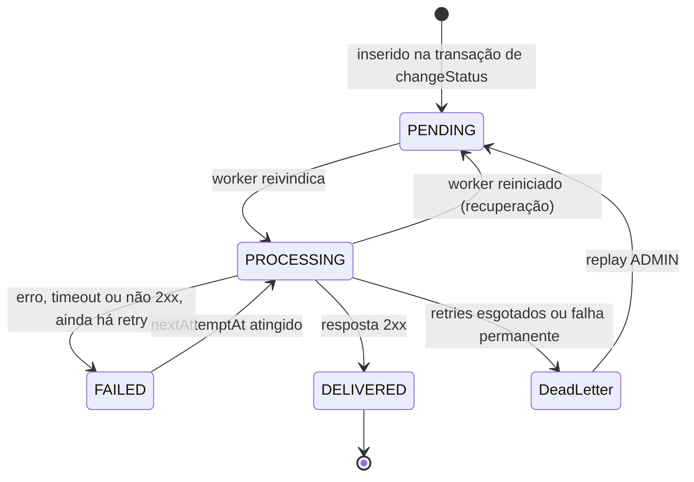
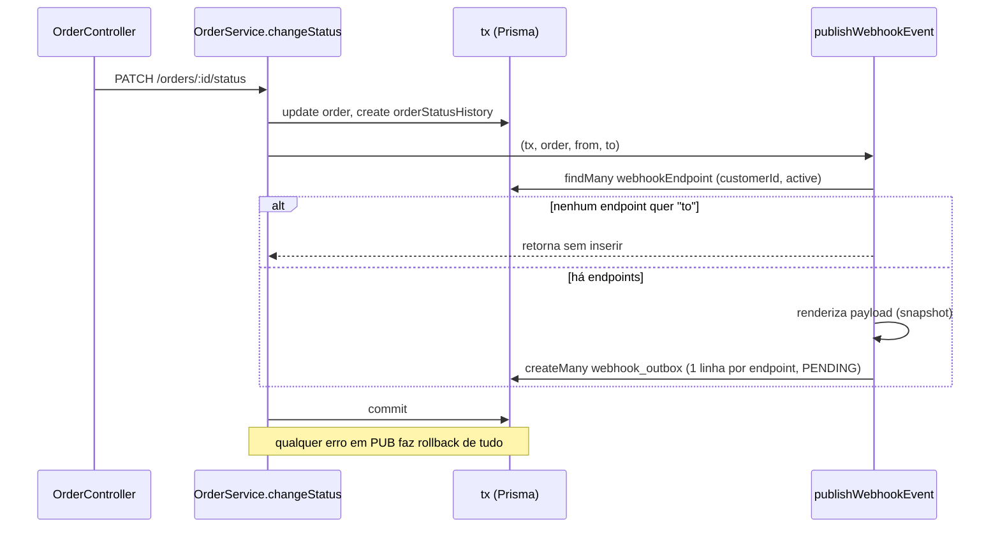

# FDD: Sistema de Webhooks de Notificação de Pedidos

Versão: 1.0 | Data: 2026-11-16 | Responsável: Larissa (Tech Lead) | Revisão de segurança: Sofia | Relacionados: [PRD](PRD.md), [RFC](RFC.md), [ADRs](adrs/README.md), [Tracker](TRACKER.md)

> Convenções deste documento: todo valor decidido traz a fonte `[hh:mm] Nome`. Nomes de colunas, rotas, códigos de erro e parâmetros que a reunião não citou levam **(derivado)** e seguem as convenções do código existente. Propostas sobre questões em aberto levam "pendente de confirmação, ver RFC-Q-nn". As rotas abaixo ficam sob o prefixo `/api/v1`, montado em `src/app.ts`. Caminhos marcados (novo, a criar) são arquivos que a feature vai criar, nomeados na reunião ([09:11] Larissa, [09:27] Bruno, [09:28] Bruno); todos os demais caminhos citados existem no repositório.

## 1. Contexto e motivação técnica

Clientes B2B consultam `GET /orders` periodicamente para descobrir mudanças de status e pediram notificação em menos de 10 segundos ([09:00] Marcos, [09:02] Marcos). A notificação é só de saída ([09:02] Marcos, [09:03] Sofia).

O ponto de origem é `OrderService.changeStatus` em `src/modules/orders/order.service.ts`: um `this.prisma.$transaction(async (tx) => ...)` que valida a transição com `canTransition` (`src/modules/orders/order.status.ts`), debita ou repõe estoque, atualiza `orders` e grava `order_status_history`. Uma chamada HTTP nesse trecho travaria a mudança de status de outros pedidos e não teria tratamento para cliente fora do ar ([09:04] Bruno). Por isso a arquitetura é outbox transacional ([ADR-001](adrs/ADR-001-outbox-transacional-no-mysql.md)), worker separado com polling ([ADR-002](adrs/ADR-002-worker-separado-com-polling.md)), retry com dead letter ([ADR-003](adrs/ADR-003-retry-com-backoff-e-dead-letter.md)), HMAC por endpoint ([ADR-004](adrs/ADR-004-hmac-sha256-com-secret-por-endpoint.md)), at-least-once ([ADR-005](adrs/ADR-005-entrega-at-least-once-com-x-event-id.md)), reuso de padrões ([ADR-006](adrs/ADR-006-reuso-dos-padroes-do-projeto.md)) e snapshot com filtro na inserção ([ADR-007](adrs/ADR-007-snapshot-e-filtro-na-insercao.md)).

Restrições do código que moldam este FDD:

- O JWT carrega só `id`, `email` e `role` do operador (`AuthUser` em `src/middlewares/auth.middleware.ts`); o `customer_id` não vem dele ([09:32] Bruno, [09:32] Larissa).
- `NotFoundError` fixa o código `NOT_FOUND` e `ValidationError` fixa `VALIDATION_ERROR` (`src/shared/errors/http-errors.ts`); códigos `WEBHOOK_*` exigem classes próprias ou classes que aceitam `code` (`BadRequestError`, `ConflictError`, `UnprocessableEntityError`).
- O projeto exige Node 20 ou superior (`package.json`), que já traz `fetch` e `node:crypto`; a entrega HTTP e o HMAC não precisam de dependência nova (derivado).

## 2. Objetivos técnicos

| ID | Objetivo | Medida ou invariante | Fonte |
|---|---|---|---|
| **FDD-OBJ-01** | Latência de notificação | Do commit da mudança de status à primeira tentativa de envio: até 2s de espera de polling mais o tempo do batch; meta total abaixo de 10s no caminho feliz | [09:02] Marcos, [09:09] Diego, [09:10] Larissa |
| **FDD-OBJ-02** | Atomicidade | Linha na `webhook_outbox` existe se e somente se a transação de `changeStatus` commitou | [09:06] Diego, [09:40] Bruno |
| **FDD-OBJ-03** | Entrega at-least-once | Todo evento enfileirado termina em `DELIVERED` ou em `webhook_dead_letter`; a única exceção é a remoção do próprio endpoint, que descarta os pendentes dele de forma explícita (6.4, derivado) | [09:24] Diego, [09:18] Diego |
| **FDD-OBJ-04** | Ordem por pedido | Para o mesmo endpoint e o mesmo `order_id`, nenhum evento é enviado antes de o anterior ser entregue ou ir para a dead letter, com um único worker | [09:12] Diego, [09:13] Larissa |
| **FDD-OBJ-05** | Retry limitado | Backoff 1m, 5m, 30m, 2h, 12h; depois, dead letter | [09:17] Diego, [09:17] Larissa |
| **FDD-OBJ-06** | Autenticidade | 100% dos envios com `X-Signature` HMAC-SHA256 do corpo, verificável com a secret do endpoint | [09:20] Sofia, [09:22] Sofia |
| **FDD-OBJ-07** | Exposição mínima da secret | A secret aparece só na resposta de criação e de rotação; nunca em listagem, edição ou log | [09:31] Marcos; "log" derivado de [09:22] Diego |

## 3. Escopo e exclusões

**Dentro do escopo:** CRUD de configuração de webhooks por customer com filtro de status ([09:31] Marcos, [09:33] Bruno); rotação de secret ([09:21] Sofia); histórico das últimas 100 entregas ([09:34] Marcos); outbox, worker, retry, dead letter e replay ADMIN ([09:06] Diego, [09:18] Diego, [09:36] Sofia); assinatura HMAC e headers de entrega ([09:44] Diego, [09:45] Diego); integração no `changeStatus` ([09:40] Bruno).

**Fora do escopo** (sem implementação nesta feature):

| Item | Situação | Fonte |
|---|---|---|
| Email ao cliente quando o webhook falha | Próxima fase, após medir impacto (RFC-Q-07) | [09:37] Larissa |
| Rate limiting de saída | Observar e decidir depois (RFC-Q-02) | [09:39] Diego, [09:39] Larissa |
| Painel visual para o cliente | Projeto separado do time de frontend | [09:40] Larissa |
| Arquivamento das linhas entregues | Fora desta feature (RFC-Q-04) | [09:08] Diego |
| Webhooks inbound | Não pedido | [09:02] Marcos |
| Múltiplos workers e ordem global | Limitação conhecida (RFC-Q-03) | [09:13] Diego, [09:13] Larissa |
| Exactly-once | Descartado | [09:25] Diego |
| Evento na criação do pedido | `OrderService.create` não passa por `changeStatus`; em aberto (RFC-Q-12) | `src/modules/orders/order.service.ts` |

## 4. Modelo de dados

Quatro models novos em `prisma/schema.prisma`, seguindo a convenção existente: `@id @default(uuid()) @db.Char(36)` ([09:51] Larissa), `@@map` em snake_case, `createdAt`/`updatedAt`. Os nomes `webhook_outbox` e `webhook_dead_letter` são da reunião ([09:06] Diego, [09:18] Diego); os demais nomes de tabela e todas as colunas não citadas são (derivado).

**Configuração de endpoint**: url, secret, customer_id e estado ativo ([09:21] Bruno, [09:21] Sofia), mais a lista de status ([09:33] Marcos).

```prisma
model WebhookEndpoint {
  id                      String    @id @default(uuid()) @db.Char(36)
  customerId              String    @db.Char(36)
  url                     String    @db.VarChar(2048)
  events                  Json      // array de OrderStatus desejados
  secret                  String    @db.VarChar(128)
  previousSecret          String?   @db.VarChar(128)
  previousSecretExpiresAt DateTime?
  active                  Boolean   @default(true)
  createdAt               DateTime  @default(now())
  updatedAt               DateTime  @updatedAt

  customer   Customer          @relation(fields: [customerId], references: [id])
  outbox     WebhookOutbox[]
  deliveries WebhookDelivery[]

  @@index([customerId, active])
  @@map("webhook_endpoints")
}
```

**Outbox**: estados pendente, processando, falhou e entregue, com índice em status e `created_at` ([09:08] Diego). O `id` da linha é o `event_id` enviado em `X-Event-Id` (derivado de [09:25] Diego, que definiu o UUID como gerado na inserção na outbox). Proposta: **uma linha por endpoint interessado** (derivado, pendente de confirmação, ver RFC-Q-10), o que dá a cada endpoint seu próprio ciclo de retry e seu próprio `X-Event-Id`.

```prisma
enum WebhookOutboxStatus {
  PENDING     // pendente
  PROCESSING  // processando
  FAILED      // falhou a última tentativa, aguardando nextAttemptAt
  DELIVERED   // entregue
}

model WebhookOutbox {
  id                String              @id @default(uuid()) @db.Char(36)
  webhookEndpointId String              @db.Char(36)
  orderId           String              @db.Char(36)
  eventType         String              @db.VarChar(64)
  payload           Json
  status            WebhookOutboxStatus @default(PENDING)
  attempts          Int                 @default(0)
  nextAttemptAt     DateTime            @default(now())
  lastError         String?             @db.Text
  deliveredAt       DateTime?
  createdAt         DateTime            @default(now())
  updatedAt         DateTime            @updatedAt

  endpoint WebhookEndpoint @relation(fields: [webhookEndpointId], references: [id], onDelete: Cascade)

  @@index([status, createdAt])
  @@index([status, nextAttemptAt])
  @@index([webhookEndpointId, orderId, createdAt])
  @@map("webhook_outbox")
}
```

O estado `FAILED` significa "tentativa falhou, aguardando retry". A falha permanente não fica na outbox: o evento sai dela e vai para a dead letter, porque marcar "failed" na própria outbox foi a alternativa descartada ([09:17] Larissa, [09:18] Diego).

**Dead letter**: payload, motivo da falha e timestamp ([09:18] Diego), mais os campos de auditoria do replay ([09:36] Sofia).

```prisma
model WebhookDeadLetter {
  id                String    @id @default(uuid()) @db.Char(36)
  eventId           String    @db.Char(36)   // id original da outbox
  webhookEndpointId String?   @db.Char(36)
  orderId           String    @db.Char(36)
  eventType         String    @db.VarChar(64)
  payload           Json
  reason            String    @db.VarChar(64)  // código WEBHOOK_*
  lastError         String?   @db.Text
  attempts          Int
  failedAt          DateTime  @default(now())
  replayedAt        DateTime?
  replayedById      String?   @db.Char(36)

  @@index([eventId])
  @@index([failedAt])
  @@map("webhook_dead_letter")
}
```

**Registro de entregas**: necessário para o histórico com sucesso ou falha, payload, response e tempo de resposta ([09:34] Marcos). Uma linha por tentativa (derivado).

```prisma
model WebhookDelivery {
  id                String   @id @default(uuid()) @db.Char(36)
  webhookEndpointId String   @db.Char(36)
  eventId           String   @db.Char(36)
  attempt           Int
  success           Boolean
  statusCode        Int?
  durationMs        Int
  requestPayload    Json
  responseBody      String?  @db.Text   // limitado a WEBHOOK_RESPONSE_BODY_MAX_BYTES
  errorCode         String?  @db.VarChar(64)
  createdAt         DateTime @default(now())

  endpoint WebhookEndpoint @relation(fields: [webhookEndpointId], references: [id], onDelete: Cascade)

  @@index([webhookEndpointId, createdAt])
  @@map("webhook_deliveries")
}
```

O model `Customer` ganha a relação `webhookEndpoints WebhookEndpoint[]`. `orderId` na outbox e na dead letter não tem FK para `orders`: o payload é snapshot e não depende do pedido continuar existindo ([09:52] Larissa) (derivado). Ao remover um endpoint, as linhas dele na outbox e no histórico são removidas em cascata, e a dead letter guarda o `webhookEndpointId` como referência solta (derivado).

## 5. Fluxos detalhados



### 5.1 Criação do evento na outbox

**FDD-FLUXO-01**. `changeStatus` chama `publishWebhookEvent(tx, order, from, to)` logo depois de gravar `orderStatusHistory`, dentro do mesmo `$transaction` ([09:41] Bruno, [09:41] Diego). A função fica em `src/modules/webhooks/webhook.service.ts` (novo, a criar) como função exportada, sem injeção no `OrderService` (derivado de [09:41] Diego).



Passos:

1. Busca, com o `tx`, os endpoints `active = true` do `order.customerId` e filtra os que têm `to` em `events`. Se nenhum, não insere nada ([09:34] Bruno). O filtro de `events` é feito em memória, já que a lista de endpoints por customer é pequena (derivado).
2. Renderiza o payload uma vez (seção 6.8) com o estado do momento ([09:52] Larissa). `timestamp` recebe o instante da mudança.
3. Insere uma linha `PENDING` por endpoint, cada uma com `id` UUID próprio, que é o `event_id` ([09:25] Diego).
4. Se qualquer passo lançar erro, a transação inteira faz rollback e o status do pedido não muda ([09:40] Bruno).

O tamanho do payload **não** é validado aqui: um erro nesse ponto desfaria a mudança de status. A checagem de 64KB acontece no worker (5.2) (derivado de [09:23] Sofia e [09:40] Bruno).

### 5.2 Processamento pelo worker

**FDD-FLUXO-02**. Processo separado iniciado por `npm run worker`, com entry em `src/worker.ts` (novo, a criar) e lógica em `src/modules/webhooks/webhook.worker.ts` (novo, a criar) ([09:11] Larissa, [09:28] Bruno). O worker cria seu PrismaClient com `createPrismaClient()` (`src/config/database.ts`) na mesma `DATABASE_URL` ([09:30] Bruno).

```mermaid
sequenceDiagram
    participant W as Worker (loop 2s)
    participant DB as MySQL
    participant C as Endpoint do cliente
    W->>DB: SELECT outbox PENDING/FAILED com nextAttemptAt <= agora, ORDER BY createdAt, LIMIT batch
    loop cada evento, em sequência
        W->>DB: pula se houver evento anterior não entregue do mesmo endpoint e order_id
        W->>DB: UPDATE status = PROCESSING
        W->>W: valida tamanho (64KB) e secret
        W->>C: POST url (headers + corpo assinado), timeout 10s
        alt 2xx
            W->>DB: status = DELIVERED, deliveredAt; insere webhook_deliveries (success)
        else erro, timeout ou não 2xx
            W->>DB: insere webhook_deliveries (falha); segue 5.3
        end
    end
```

1. **Ciclo:** a cada `WEBHOOK_POLL_INTERVAL_MS` (2000, [09:09] Diego) busca até `WEBHOOK_BATCH_SIZE` eventos (default 10, derivado de "batch pequeno", [09:08] Diego) com `status IN (PENDING, FAILED)` e `nextAttemptAt <= agora`, ordenados por `createdAt` ([09:12] Diego).
2. **Ordem por pedido:** um evento só é enviado se não houver, para o mesmo `webhookEndpointId` e `orderId`, outro evento mais antigo ainda na outbox sem estar `DELIVERED`. Sem essa regra, um retry deixaria o evento seguinte do pedido chegar antes (derivado, necessário para manter a garantia de [09:12] Diego com retry).
3. **Envio sequencial:** um evento por vez, para preservar a ordem com um único worker ([09:12] Diego) (derivado).
4. **Pré-checagens (falha permanente, sem HTTP):** corpo serializado acima de 64KB gera `WEBHOOK_PAYLOAD_TOO_LARGE` e o evento vai direto para a dead letter, sem truncar ([09:23] Sofia, [09:24] Diego, [09:24] Larissa). Endpoint inativo (`WEBHOOK_ENDPOINT_INACTIVE`) ou sem secret (`WEBHOOK_SECRET_REQUIRED`) também vão direto para a dead letter (derivado).
5. **Envio:** `fetch` nativo com `AbortSignal.timeout(10000)` ([09:42] Diego), método POST (derivado), sem seguir redirecionamentos (derivado), headers e corpo da seção 6.8.
6. **Resultado:** resposta 2xx marca `DELIVERED`; qualquer outra resposta, timeout ou erro de rede é falha retryable ([09:42] Diego) (derivado para "não 2xx").
7. **Registro:** toda tentativa grava uma linha em `webhook_deliveries` com status code, duração, payload e corpo da resposta limitado (derivado de [09:34] Marcos).
8. **Recuperação:** ao iniciar, o worker devolve para `PENDING` as linhas que ficaram em `PROCESSING` por queda anterior. Isso pode gerar reenvio, coberto pelo at-least-once ([09:24] Diego) (derivado).
9. **Encerramento:** em `SIGINT`/`SIGTERM`, termina o evento corrente, para o loop e chama `prisma.$disconnect()`, no mesmo padrão de `src/server.ts` (derivado).

### 5.3 Retry com backoff

**FDD-FLUXO-03**. A cada falha retryable, `attempts` é incrementado e `nextAttemptAt` recebe o próximo intervalo da tabela. Interpretação: as **5 tentativas** decididas ([09:17] Larissa) são as 5 retentativas após a falha inicial, uma por intervalo de 1m/5m/30m/2h/12h; com o envio original, são 6 envios, o que fecha "quase 15 horas entre primeira falha e última tentativa" ([09:17] Diego) (pendente de confirmação, ver RFC-Q-08).

| Envio | Quando | Intervalo desde o envio anterior | Fonte |
|---|---|---|---|
| 1 (original) | primeiro ciclo após o commit | n/a | [09:09] Diego |
| 2 (retry 1) | +1 min | 1m | [09:17] Diego |
| 3 (retry 2) | +6 min | 5m | [09:17] Diego |
| 4 (retry 3) | +36 min | 30m | [09:17] Diego |
| 5 (retry 4) | +2h36 | 2h | [09:17] Diego |
| 6 (retry 5) | +14h36 | 12h | [09:17] Diego |

Se o envio 6 falhar, o evento segue para 5.4 com motivo `WEBHOOK_RETRIES_EXHAUSTED` (derivado). Retry indefinido e 3 tentativas foram descartados ([09:15] Diego, [09:16] Diego).

### 5.4 DLQ e replay manual

**FDD-FLUXO-04**. Movimento para a dead letter, em uma transação: insere em `webhook_dead_letter` (`eventId` = id da outbox, payload, `reason`, `lastError`, `attempts`, `failedAt`) e remove a linha da outbox ([09:18] Diego) (remoção derivada). O worker registra o log `webhook_event_dead_lettered` com o `deadLetterId`, que é como o ADMIN obtém o id para o replay, já que a reunião não pediu listagem da dead letter (derivado).

```mermaid
sequenceDiagram
    participant A as ADMIN
    participant R as webhook.routes (admin)
    participant S as WebhookService
    participant DB as MySQL
    A->>R: POST /admin/webhooks/dead-letter/:id/replay
    R->>R: authenticate + requireRole('ADMIN')
    R->>S: replay(id, user)
    S->>DB: busca dead letter; valida não reprocessado e endpoint ativo
    S->>DB: transação: insere outbox PENDING (mesmo id, attempts 0) + marca replayedAt/replayedById
    S->>S: logger.info webhook_dead_letter_replayed (userId)
    S-->>A: 200 com eventId e status PENDING
```

- Só role `ADMIN`, via `requireRole` existente ([09:36] Sofia, [09:36] Larissa). OPERATOR recebe 403 `FORBIDDEN`, gerado pelo próprio middleware.
- O evento volta para a outbox como `PENDING` ([09:18] Diego), com o **mesmo `id`**, para que o cliente consiga deduplicar se uma tentativa anterior chegou a ser processada (derivado, pendente de confirmação, ver RFC-Q-09).
- Auditoria: `replayedById` na dead letter e log com o `userId` de quem executou ([09:36] Sofia).
- Uma linha da dead letter só pode ser reprocessada uma vez (`WEBHOOK_ALREADY_REPLAYED`); se o evento falhar de novo, ele gera uma nova linha na dead letter (derivado).

### 5.5 Gestão de secret e rotação

**FDD-FLUXO-05**.

- **Geração:** na criação, a plataforma gera a secret com `crypto.randomBytes(32)` em hexadecimal (64 caracteres) e a devolve uma única vez ([09:31] Marcos) (algoritmo e tamanho derivados).
- **Rotação:** gera nova secret, move a atual para `previousSecret` com `previousSecretExpiresAt = agora + 24h` e devolve a nova ([09:21] Sofia). Uma nova rotação durante a convivência descarta a secret anterior imediatamente (derivado).
- **Assinatura:** `HMAC-SHA256(secret, corpo bruto)` em hexadecimal, no header `X-Signature` com prefixo `sha256=` ([09:20] Sofia, [09:22] Sofia) (formato derivado).
- **Durante as 24h:** `X-Signature` leva as duas assinaturas separadas por vírgula, a da secret nova primeiro, para o cliente validar com qualquer uma enquanto migra (derivado, pendente de confirmação, ver RFC-Q-06).
- **Armazenamento:** a secret fica recuperável no banco porque o HMAC exige o valor original; criptografia em repouso faz parte da revisão da Sofia ([09:46] Sofia) (pendente de confirmação, ver RFC-Q-06).
- **Logs:** `*.secret` e `*.previousSecret` entram no `redact` do logger (derivado de [09:22] Diego).

## 6. Contratos públicos

Formato de erro: o do `errorMiddleware` (`src/middlewares/error.middleware.ts`), `{ "error": { "code", "message", "details?" } }`. Autenticação: `Authorization: Bearer <jwt>` via `authenticate`; sem token, 401 `UNAUTHORIZED`. O CRUD aceita qualquer role autenticada ([09:37] Sofia). Nenhuma resposta, exceto criação e rotação, contém `secret` ([09:31] Marcos).

Sobre o `customerId`: proposta de `customerId` no **body** na criação e na **query** da listagem, nunca do JWT ([09:32] Larissa) (pendente de confirmação, ver RFC-Q-01).

### 6.1 Criar webhook

**FDD-CONTRATO-01**. `POST /api/v1/webhooks` | auth: qualquer role | fonte: [09:31] Marcos, [09:33] Marcos.

Regras do body: `url` com protocolo `https:` ([09:23] Sofia); `events` com 1 ou mais status distintos entre `PAID`, `PROCESSING`, `SHIPPED`, `DELIVERED`, `CANCELLED`. `PENDING` fica de fora porque nenhuma transição leva a ele (`src/modules/orders/order.status.ts`) e a criação do pedido não gera evento (derivado, ver RFC-Q-12).

Exemplo de requisição:

```http
POST /api/v1/webhooks HTTP/1.1
Authorization: Bearer <jwt do operador>
Content-Type: application/json
```

```json
{
  "customerId": "6f1c2a9e-3b7d-4c11-9a51-2f0e8d4b7a10",
  "url": "https://erp.atlas.example/webhooks/orders",
  "events": ["SHIPPED", "DELIVERED"]
}
```

Resposta `201 Created` (única resposta de CRUD que traz a secret):

```json
{
  "id": "0b7e4f52-9d1a-4c3e-8f6b-5a2d9c1e7f33",
  "customerId": "6f1c2a9e-3b7d-4c11-9a51-2f0e8d4b7a10",
  "url": "https://erp.atlas.example/webhooks/orders",
  "events": ["SHIPPED", "DELIVERED"],
  "active": true,
  "secret": "9f2c4e1a7b3d5f60c8e2a4b6d8f0a1c3e5b7d9f1a3c5e7b9d1f3a5c7e9b1d3f5",
  "createdAt": "2026-11-16T12:00:00.000Z",
  "updatedAt": "2026-11-16T12:00:00.000Z"
}
```

Erros: `400` (URL http ou corpo inválido), `401`, `404 NOT_FOUND` (customer inexistente, via `NotFoundError('Customer')`). Exemplo de URL http recusada:

```json
{
  "error": {
    "code": "VALIDATION_ERROR",
    "message": "Validation failed",
    "details": [{ "path": "url", "message": "WEBHOOK_INVALID_URL: url must use https" }]
  }
}
```

### 6.2 Listar webhooks do customer

**FDD-CONTRATO-02**. `GET /api/v1/webhooks?customerId=<uuid>&page=1&pageSize=20` | auth: qualquer role | fonte: [09:33] Bruno. `customerId` obrigatório (pendente de confirmação, ver RFC-Q-01); paginação no formato de `paginated()` (`src/shared/http/response.ts`).

Exemplo de requisição (sem corpo):

```http
GET /api/v1/webhooks?customerId=6f1c2a9e-3b7d-4c11-9a51-2f0e8d4b7a10&page=1&pageSize=20 HTTP/1.1
Authorization: Bearer <jwt do operador>
```

Resposta `200 OK`:

```json
{
  "data": [
    {
      "id": "0b7e4f52-9d1a-4c3e-8f6b-5a2d9c1e7f33",
      "customerId": "6f1c2a9e-3b7d-4c11-9a51-2f0e8d4b7a10",
      "url": "https://erp.atlas.example/webhooks/orders",
      "events": ["SHIPPED", "DELIVERED"],
      "active": true,
      "createdAt": "2026-11-16T12:00:00.000Z",
      "updatedAt": "2026-11-16T12:00:00.000Z"
    }
  ],
  "pagination": { "page": 1, "pageSize": 20, "total": 1, "totalPages": 1 }
}
```

Erros: `400 VALIDATION_ERROR` (sem `customerId` ou UUID inválido), `401`.

### 6.3 Editar webhook

**FDD-CONTRATO-03**. `PATCH /api/v1/webhooks/:id` | auth: qualquer role | fonte: [09:33] Bruno. Campos opcionais: `url`, `events`, `active` ([09:21] Bruno). A secret não é editável por aqui. Alterações não afetam eventos já enfileirados, que guardam snapshot ([09:52] Larissa) (derivado).

Exemplo de requisição:

```http
PATCH /api/v1/webhooks/0b7e4f52-9d1a-4c3e-8f6b-5a2d9c1e7f33 HTTP/1.1
Authorization: Bearer <jwt do operador>
Content-Type: application/json
```

```json
{ "events": ["PAID", "SHIPPED", "DELIVERED"], "active": false }
```

Resposta `200 OK`:

```json
{
  "id": "0b7e4f52-9d1a-4c3e-8f6b-5a2d9c1e7f33",
  "customerId": "6f1c2a9e-3b7d-4c11-9a51-2f0e8d4b7a10",
  "url": "https://erp.atlas.example/webhooks/orders",
  "events": ["PAID", "SHIPPED", "DELIVERED"],
  "active": false,
  "createdAt": "2026-11-16T12:00:00.000Z",
  "updatedAt": "2026-11-16T12:30:00.000Z"
}
```

Erros: `400`, `401`, `404 WEBHOOK_NOT_FOUND`.

### 6.4 Remover webhook

**FDD-CONTRATO-04**. `DELETE /api/v1/webhooks/:id` | auth: qualquer role | fonte: [09:33] Bruno. Resposta `204 No Content`, sem corpo. Os eventos ainda pendentes desse endpoint e o histórico dele são **descartados** em cascata, sem ir para a dead letter: o cliente pediu para não receber mais nada naquela URL (derivado). Para pausar sem perder eventos, o caminho é `PATCH` com `active: false`, que manda os pendentes para a dead letter (5.2).

Exemplo de requisição (sem corpo) e resposta de sucesso:

```http
DELETE /api/v1/webhooks/0b7e4f52-9d1a-4c3e-8f6b-5a2d9c1e7f33 HTTP/1.1
Authorization: Bearer <jwt do operador>
```

```http
HTTP/1.1 204 No Content
```

Erro `404`:

```json
{ "error": { "code": "WEBHOOK_NOT_FOUND", "message": "Webhook not found" } }
```

### 6.5 Rotacionar secret

**FDD-CONTRATO-05**. `POST /api/v1/webhooks/:id/rotate-secret` (rota derivada; a reunião definiu só a capacidade, [09:21] Sofia) | auth: qualquer role, como o resto do CRUD ([09:37] Sofia). Sem corpo de request.

Exemplo de requisição:

```http
POST /api/v1/webhooks/0b7e4f52-9d1a-4c3e-8f6b-5a2d9c1e7f33/rotate-secret HTTP/1.1
Authorization: Bearer <jwt do operador>
```

Resposta `200 OK` (única resposta, além da criação, que traz a secret):

```json
{
  "id": "0b7e4f52-9d1a-4c3e-8f6b-5a2d9c1e7f33",
  "secret": "4a6c8e0b2d4f6a8c0e2b4d6f8a0c2e4b6d8f0a2c4e6b8d0f2a4c6e8b0d2f4a6c",
  "previousSecretExpiresAt": "2026-11-17T12:30:00.000Z"
}
```

Erros: `401`, `404 WEBHOOK_NOT_FOUND`.

### 6.6 Histórico de entregas

**FDD-CONTRATO-06**. `GET /api/v1/webhooks/:id/deliveries` | auth: qualquer role | fonte: [09:34] Marcos, [09:35] Larissa. Retorna os **últimos 100** envios, do mais recente para o mais antigo ([09:34] Marcos), com sucesso ou falha, payload, response e tempo de resposta. Cada tentativa conta como um envio, inclusive os retries (derivado).

Exemplo de requisição (sem corpo):

```http
GET /api/v1/webhooks/0b7e4f52-9d1a-4c3e-8f6b-5a2d9c1e7f33/deliveries HTTP/1.1
Authorization: Bearer <jwt do operador>
```

Resposta `200 OK`:

```json
{
  "data": [
    {
      "id": "c2d4e6f8-1a3b-4c5d-8e7f-9a0b1c2d3e4f",
      "eventId": "7d9b1f3e-5a7c-4e9b-8d1f-3a5c7e9b1d3f",
      "attempt": 2,
      "success": true,
      "statusCode": 200,
      "durationMs": 184,
      "requestPayload": { "event_id": "7d9b1f3e-5a7c-4e9b-8d1f-3a5c7e9b1d3f", "event_type": "order.status_changed", "to_status": "SHIPPED" },
      "responseBody": "{\"received\":true}",
      "errorCode": null,
      "createdAt": "2026-11-16T12:01:14.000Z"
    },
    {
      "id": "b1c3e5f7-0a2b-4c4d-8e6f-8a9b0c1d2e3f",
      "eventId": "7d9b1f3e-5a7c-4e9b-8d1f-3a5c7e9b1d3f",
      "attempt": 1,
      "success": false,
      "statusCode": null,
      "durationMs": 10000,
      "requestPayload": { "event_id": "7d9b1f3e-5a7c-4e9b-8d1f-3a5c7e9b1d3f", "event_type": "order.status_changed", "to_status": "SHIPPED" },
      "responseBody": null,
      "errorCode": "WEBHOOK_DELIVERY_TIMEOUT",
      "createdAt": "2026-11-16T12:00:12.000Z"
    }
  ]
}
```

O `requestPayload` aparece abreviado no exemplo; na resposta real ele é o payload completo da seção 6.8. Erros: `401`, `404 WEBHOOK_NOT_FOUND`.

### 6.7 Replay de evento da dead letter

**FDD-CONTRATO-07**. `POST /api/v1/admin/webhooks/dead-letter/:id/replay` | auth: **ADMIN** via `requireRole('ADMIN')` | fonte: [09:18] Diego, [09:35] Diego, [09:36] Sofia. Sem corpo de request.

Exemplo de requisição (o token precisa ser de um usuário com role `ADMIN`):

```http
POST /api/v1/admin/webhooks/dead-letter/e4f6a8b0-2c4d-4e6f-8a0b-2c4d6e8f0a1b/replay HTTP/1.1
Authorization: Bearer <jwt de ADMIN>
```

Resposta `200 OK`:

```json
{
  "deadLetterId": "e4f6a8b0-2c4d-4e6f-8a0b-2c4d6e8f0a1b",
  "eventId": "7d9b1f3e-5a7c-4e9b-8d1f-3a5c7e9b1d3f",
  "status": "PENDING",
  "replayedAt": "2026-11-17T09:00:00.000Z",
  "replayedById": "a1b2c3d4-e5f6-4a7b-8c9d-0e1f2a3b4c5d"
}
```

Erro `403` para OPERATOR (gerado pelo `requireRole` existente):

```json
{ "error": { "code": "FORBIDDEN", "message": "Insufficient permissions" } }
```

Outros erros: `401`, `404 WEBHOOK_DEAD_LETTER_NOT_FOUND`, `409 WEBHOOK_ALREADY_REPLAYED`, `422 WEBHOOK_ENDPOINT_INACTIVE`.

### 6.8 Webhook de saída (plataforma → cliente)

**FDD-CONTRATO-08**. `POST <url cadastrada>` (método derivado) | fonte: [09:43] Diego, [09:44] Diego, [09:44] Sofia, [09:45] Diego.

| Header | Valor | Fonte |
|---|---|---|
| `Content-Type` | `application/json` | [09:44] Diego |
| `X-Event-Id` | UUID do evento (id da linha da outbox) | [09:25] Diego |
| `X-Signature` | `sha256=<hex>`; durante a rotação, `sha256=<nova>,sha256=<antiga>` (formato derivado, RFC-Q-06) | [09:20] Sofia |
| `X-Timestamp` | instante do envio, ISO 8601 (formato derivado) | [09:44] Diego |
| `X-Webhook-Id` | id do endpoint cadastrado | [09:44] Sofia, [09:45] Diego |

Corpo, enxuto e sem items ([09:43] Diego, [09:44] Bruno):

```json
{
  "event_id": "7d9b1f3e-5a7c-4e9b-8d1f-3a5c7e9b1d3f",
  "event_type": "order.status_changed",
  "timestamp": "2026-11-16T12:00:00.000Z",
  "order_id": "5c7e9a1b-3d5f-4a7c-9e1b-3d5f7a9c1e3b",
  "order_number": "ORD-000123",
  "from_status": "PROCESSING",
  "to_status": "SHIPPED",
  "customer_id": "6f1c2a9e-3b7d-4c11-9a51-2f0e8d4b7a10",
  "total_cents": 18500
}
```

Exemplo de requisição completa, como chega ao cliente (o corpo é o JSON acima, serializado):

```http
POST /webhooks/orders HTTP/1.1
Host: erp.atlas.example
Content-Type: application/json
X-Event-Id: 7d9b1f3e-5a7c-4e9b-8d1f-3a5c7e9b1d3f
X-Webhook-Id: 0b7e4f52-9d1a-4c3e-8f6b-5a2d9c1e7f33
X-Timestamp: 2026-11-16T12:00:02.000Z
X-Signature: sha256=<HMAC-SHA256 do corpo bruto, em hexadecimal>

{"event_id":"7d9b1f3e-5a7c-4e9b-8d1f-3a5c7e9b1d3f","event_type":"order.status_changed", ...}
```

Exemplo de resposta do cliente que confirma a entrega. O corpo é livre e só é guardado no histórico (6.6), limitado por `WEBHOOK_RESPONSE_BODY_MAX_BYTES` (derivado):

```http
HTTP/1.1 200 OK
Content-Type: application/json

{"received":true}
```

Semântica da resposta do cliente: qualquer `2xx` confirma a entrega; outro status, ausência de resposta em 10s ([09:42] Diego) ou erro de rede contam como falha e seguem para retry (derivado para "não 2xx"). O cliente deve validar `X-Signature` com o corpo bruto e deduplicar por `X-Event-Id` ([09:25] Diego); essa orientação vai para o portal do desenvolvedor ([09:26] Marcos). `X-Timestamp` não entra no conteúdo assinado nesta versão (pendente de confirmação, ver RFC-Q-06).

## 7. Matriz de erros

Os três primeiros códigos foram citados na reunião ([09:28] Bruno); os demais seguem a convenção do prefixo `WEBHOOK_` ([09:29] Larissa) e são (derivado). As classes novas ficam em `src/shared/errors/http-errors.ts`, ao lado de `InsufficientStockError` (derivado do local atual das classes específicas, padrão que [09:28] Bruno pediu para seguir).

| ID | Código | HTTP | Quando ocorre | Classe base (existente) | Tratamento | Fonte |
|---|---|---|---|---|---|---|
| **FDD-ERR-01** | `WEBHOOK_NOT_FOUND` | 404 | Endpoint inexistente em PATCH, DELETE, rotação ou deliveries | `AppError` (404), porque `NotFoundError` fixa o código `NOT_FOUND` | Resposta de erro padrão | [09:28] Bruno |
| **FDD-ERR-02** | `WEBHOOK_INVALID_URL` | 400 | URL sem `https:` ou malformada | `ValidationError` via `validate.middleware`; o código vai em `details[].message` (derivado, para não alterar o middleware) | Recusa no schema Zod | [09:28] Bruno, [09:23] Sofia |
| **FDD-ERR-03** | `WEBHOOK_SECRET_REQUIRED` | n/a (worker) | Endpoint sem secret no momento do envio (interpretação derivada, ver RFC-Q-11) | n/a | **Permanente**: direto para a dead letter, sem HTTP | [09:28] Bruno |
| **FDD-ERR-04** | `WEBHOOK_DEAD_LETTER_NOT_FOUND` | 404 | Replay com id inexistente | `AppError` (404) | Resposta de erro padrão | (derivado) |
| **FDD-ERR-05** | `WEBHOOK_ALREADY_REPLAYED` | 409 | Replay de linha já reprocessada | `ConflictError` | Resposta de erro padrão | (derivado) |
| **FDD-ERR-06** | `WEBHOOK_ENDPOINT_INACTIVE` | 422 / n/a (worker) | Replay para endpoint removido ou inativo; ou worker encontra endpoint inativo | `UnprocessableEntityError` | API: recusa; worker: **permanente**, para a dead letter | (derivado) |
| **FDD-ERR-07** | `WEBHOOK_PAYLOAD_TOO_LARGE` | n/a (worker) | Corpo serializado acima de 64KB | n/a | **Permanente**: dead letter, sem truncar | [09:23] Sofia, [09:24] Larissa |
| **FDD-ERR-08** | `WEBHOOK_DELIVERY_TIMEOUT` | n/a (worker) | Cliente não respondeu em 10s | n/a | **Retryable** (5.3) | [09:42] Diego |
| **FDD-ERR-09** | `WEBHOOK_DELIVERY_FAILED` | n/a (worker) | Resposta não 2xx ou erro de rede | n/a | **Retryable** (5.3) | [09:42] Diego (derivado para não 2xx) |
| **FDD-ERR-10** | `WEBHOOK_RETRIES_EXHAUSTED` | n/a (worker) | Envio 6 falhou | n/a | **Permanente**: dead letter | [09:15] Diego, [09:17] Larissa |

Erros reaproveitados sem código novo: `VALIDATION_ERROR` (400) para os demais campos, `UNAUTHORIZED` (401), `FORBIDDEN` (403) do `requireRole` e `NOT_FOUND` (404) para customer inexistente.

## 8. Estratégias de resiliência

| ID | Estratégia | Detalhe | Fonte |
|---|---|---|---|
| **FDD-RES-01** | Outbox transacional | Evento e mudança de status commitam ou fazem rollback juntos | [09:06] Diego, [09:40] Bruno |
| **FDD-RES-02** | Timeout | 10s por chamada, via `AbortSignal.timeout` | [09:42] Diego |
| **FDD-RES-03** | Retry com backoff | 1m, 5m, 30m, 2h, 12h, controlado por `nextAttemptAt` | [09:17] Diego |
| **FDD-RES-04** | Dead letter | Falhas permanentes e retries esgotados saem da outbox para `webhook_dead_letter` | [09:18] Diego |
| **FDD-RES-05** | Idempotência no cliente | `X-Event-Id` estável entre retries e no replay | [09:25] Diego (replay: RFC-Q-09) |
| **FDD-RES-06** | Recuperação de queda | `PROCESSING` volta a `PENDING` na inicialização do worker | (derivado de [09:24] Diego) |
| **FDD-RES-07** | Ordem por pedido com retry | Bloqueio por `webhookEndpointId` + `orderId` enquanto houver evento anterior pendente | (derivado de [09:12] Diego) |
| **FDD-RES-08** | Isolamento de processo | Queda ou deploy da API não para o worker, e vice-versa | [09:11] Diego |
| **FDD-RES-09** | Encerramento gracioso | Termina o evento corrente antes de sair em `SIGTERM` | (derivado de `src/server.ts`) |

## 9. Observabilidade

O projeto hoje só tem logs Pino (`src/shared/logger/index.ts`) e correlação por `X-Request-Id` (`src/middlewares/request-logger.middleware.ts`); não há biblioteca de métricas nem de tracing em `package.json`. Esta seção não adiciona ferramenta: propõe o mínimo sobre o que existe.

### Métricas

**FDD-OBS-01** (derivado). Calculadas a partir das tabelas e emitidas pelo worker em um log estruturado `webhook_worker_stats` a cada `WEBHOOK_STATS_INTERVAL_MS` (default 60000, derivado):

| Métrica | Como se obtém | Para quê |
|---|---|---|
| `webhook_outbox_pending` | contagem `PENDING` + `FAILED` | Tamanho da fila |
| `webhook_outbox_oldest_pending_age_seconds` | agora menos o `createdAt` mais antigo pendente | Atraso frente ao alvo de 10s ([09:02] Marcos) |
| `webhook_delivery_attempts` por `success` | contagem em `webhook_deliveries` no intervalo | Taxa de sucesso |
| `webhook_delivery_duration_ms` p50/p95 | `durationMs` no intervalo | Clientes lentos frente ao timeout de 10s ([09:42] Diego) |
| `webhook_dead_letter_new` | linhas novas na dead letter no intervalo | Falhas permanentes que pedem replay |

### Logs

**FDD-OBS-02**. Pino, sem logger novo ([09:29] Bruno), com campos estruturados e `eventId` em todos os eventos do worker (nomes derivados, no estilo `http_request` e `server_started` do código atual):

| Evento | Nível | Campos | Fonte |
|---|---|---|---|
| `webhook_event_enqueued` | info | `eventId`, `webhookEndpointId`, `orderId`, `toStatus` | (derivado) |
| `webhook_delivery_attempt` | info / warn | `eventId`, `attempt`, `statusCode`, `durationMs`, `success`, `errorCode` | (derivado de [09:34] Marcos) |
| `webhook_event_dead_lettered` | error | `deadLetterId`, `eventId`, `reason` | (derivado de [09:18] Diego) |
| `webhook_dead_letter_replayed` | info | `deadLetterId`, `eventId`, `userId`, `requestId` | [09:36] Sofia |
| `webhook_secret_rotated` | info | `webhookEndpointId`, `userId` (nunca a secret) | (derivado de [09:21] Sofia) |
| `webhook_worker_started` / `webhook_worker_stopped` | info | `pollIntervalMs`, `batchSize` / `signal` | (derivado) |

**FDD-OBS-03**. Redact: incluir `*.secret`, `*.previousSecret` e `req.body.secret` em `redactPaths` (derivado de [09:22] Diego). O log de auditoria do replay é o registro de "quem fez o replay" exigido por [09:36] Sofia, junto com `replayedById` na tabela.

### Tracing

**FDD-OBS-04** (derivado). Não há tracing distribuído no projeto e esta feature não introduz ferramenta. A correlação ponta a ponta usa chaves já presentes: `orderId` liga a mudança de status (`http_request` da API) ao evento; `eventId` liga outbox, tentativas, dead letter e o `X-Event-Id` que o cliente recebe; `requestId` liga o replay à chamada HTTP do ADMIN.

## 10. Integração com o sistema existente

Arquivos existentes:

| ID | Arquivo | O que muda | Fonte |
|---|---|---|---|
| **FDD-INT-01** | `src/modules/orders/order.service.ts` | `changeStatus` chama `publishWebhookEvent(tx, order, from, to)` após `orderStatusHistory.create`, dentro do `$transaction`; construtor do `OrderService` inalterado | [09:40] Bruno, [09:41] Bruno, [09:41] Diego |
| **FDD-INT-02** | `prisma/schema.prisma` | Novos models e enum da seção 4; relação `webhookEndpoints` em `Customer`; nova migration | [09:06] Diego, [09:18] Diego, [09:51] Larissa |
| **FDD-INT-03** | `src/app.ts` | `buildControllers` instancia `WebhookRepository`, `WebhookService`, `WebhookController` | [09:27] Bruno |
| **FDD-INT-04** | `src/routes/index.ts` | Tipo `Controllers` ganha `webhooks`; `router.use('/webhooks', ...)` e `router.use('/admin/webhooks', ...)` | [09:27] Bruno |
| **FDD-INT-05** | `src/shared/errors/http-errors.ts` | Novas classes da matriz de erros, no padrão de `InsufficientStockError` | [09:28] Bruno |
| **FDD-INT-06** | `src/shared/errors/index.ts` | Exporta as novas classes | [09:28] Bruno |
| **FDD-INT-07** | `src/shared/logger/index.ts` | `redactPaths` ganha os campos de secret | (derivado de [09:22] Diego) |
| **FDD-INT-08** | `src/config/env.ts` | `envSchema` ganha os parâmetros opcionais da seção 14, com default | (derivado) |
| **FDD-INT-09** | `package.json` | Scripts `worker`, no mesmo padrão do script `start` (código compilado), e `worker:dev`, no padrão do script `dev`, ambos para a entry `src/worker.ts` (novo, a criar); nenhuma dependência nova | [09:11] Larissa, [09:29] Bruno |
| **FDD-INT-10** | `tests/setup.ts` | `beforeEach` apaga `webhookDelivery`, `webhookDeadLetter`, `webhookOutbox` e `webhookEndpoint` antes de `customer` | (derivado do padrão do arquivo) |
| **FDD-INT-11** | `src/middlewares/auth.middleware.ts` | Reutilizado sem mudança: `authenticate` no CRUD, `requireRole('ADMIN')` no replay | [09:36] Larissa |
| **FDD-INT-12** | `src/middlewares/error.middleware.ts` | Reutilizado sem mudança | [09:29] Bruno |
| **FDD-INT-13** | `src/middlewares/validate.middleware.ts` | Reutilizado sem mudança para body, query e params | [09:30] Larissa |
| **FDD-INT-14** | `src/shared/http/response.ts` | `paginated()` reutilizado na listagem | (derivado) |
| **FDD-INT-15** | `src/config/database.ts` | `createPrismaClient()` reutilizado pelo worker | [09:30] Bruno |
| **FDD-INT-16** | `src/server.ts` | Sem mudança; modelo de bootstrap e shutdown para o worker | [09:11] Larissa |

Arquivos novos (todos (novo, a criar)):

| Arquivo | Conteúdo | Fonte |
|---|---|---|
| `src/worker.ts` (novo, a criar) | Entry do worker: PrismaClient próprio, loop, sinais | [09:11] Larissa, [09:30] Bruno |
| `src/modules/webhooks/webhook.routes.ts` (novo, a criar) | `buildWebhookRouter` e `buildWebhookAdminRouter` | [09:27] Bruno |
| `src/modules/webhooks/webhook.controller.ts` (novo, a criar) | Handlers das rotas 6.1 a 6.7 | [09:27] Bruno |
| `src/modules/webhooks/webhook.service.ts` (novo, a criar) | Regras do CRUD, rotação, replay e `publishWebhookEvent` | [09:27] Bruno, [09:41] Bruno |
| `src/modules/webhooks/webhook.repository.ts` (novo, a criar) | Acesso às quatro tabelas | [09:27] Bruno |
| `src/modules/webhooks/webhook.schemas.ts` (novo, a criar) | Schemas Zod (https, events, ids, paginação) | [09:23] Sofia, [09:30] Larissa |
| `src/modules/webhooks/webhook.worker.ts` (novo, a criar) | `processBatch()` testável, envio, assinatura, retry, dead letter | [09:28] Bruno |

Escolhemos `webhook.worker.ts` entre as duas opções citadas ([09:28] Bruno) (derivado). Os testes ficam em um novo `webhooks.test.ts` na pasta de testes, no padrão de `tests/orders.test.ts` (derivado).

## 11. Dependências e compatibilidade

- **Sem dependência nova** (derivado de [09:29] Bruno): `fetch` e `AbortSignal.timeout` nativos do Node 20 (`engines` em `package.json`); HMAC com `node:crypto`; UUID pelo `@default(uuid())` do Prisma ou pelo pacote `uuid` já instalado.
- **Banco:** mesmo MySQL e `DATABASE_URL`; migration aditiva (quatro tabelas novas e uma relação), sem alterar colunas existentes ([09:07] Diego, [09:30] Bruno).
- **API existente:** nenhum contrato atual muda. `PATCH /api/v1/orders/:id/status` passa a poder falhar se a gravação na outbox falhar, o que é comportamento desejado ([09:40] Bruno).
- **Deploy:** um segundo processo (`npm run worker`) além da API ([09:11] Diego).
- **Clientes:** precisam aceitar POST JSON em https, validar HMAC-SHA256 e deduplicar por `X-Event-Id`; orientação no portal ([09:26] Marcos, [09:40] Marcos).
- **Revisão de segurança:** HMAC e geração de secret passam pela Sofia, com 2 dias úteis antes do deploy ([09:46] Sofia).

## 12. Critérios de aceite técnicos

Testes com vitest e supertest, no padrão de `tests/orders.test.ts` (`getTestApp`, `bootstrapAuthenticatedUser`, `createTestCustomer` de `tests/helpers/factories.ts`). Para o worker, os testes chamam `processBatch()` uma vez contra um servidor HTTP local (`node:http`) em vez de esperar o loop.

- [ ] **FDD-AC-01** Mudar o status de um pedido cujo customer tem endpoint ativo com aquele status cria exatamente uma linha `PENDING` por endpoint, com payload contendo `event_id`, `event_type = order.status_changed`, `order_id`, `order_number`, `from_status`, `to_status`, `customer_id`, `total_cents` e sem `items`.
- [ ] **FDD-AC-02** Mudar para um status que nenhum endpoint do customer quer não cria linha na outbox; endpoint com `active = false` é ignorado.
- [ ] **FDD-AC-03** Se `publishWebhookEvent` lançar erro (forçado com `vi.mock` do módulo de webhooks, já que exports ESM não aceitam `vi.spyOn`), `PATCH /orders/:id/status` falha, o status do pedido não muda e nenhum `orderStatusHistory` novo é gravado.
- [ ] **FDD-AC-04** `POST /webhooks` com `url` http retorna 400 `VALIDATION_ERROR` com `WEBHOOK_INVALID_URL` em `details`.
- [ ] **FDD-AC-05** `POST /webhooks` retorna 201 com `secret` de 64 caracteres hexadecimais; `GET /webhooks` e `PATCH /webhooks/:id` nunca trazem `secret`.
- [ ] **FDD-AC-06** `GET /webhooks` sem `customerId` retorna 400; com `customerId` retorna só os endpoints daquele customer, no formato `paginated`.
- [ ] **FDD-AC-07** `PATCH` e `DELETE` com id inexistente retornam 404 `WEBHOOK_NOT_FOUND`; `DELETE` existente retorna 204 sem corpo.
- [ ] **FDD-AC-08** `POST /webhooks/:id/rotate-secret` retorna secret diferente da anterior e `previousSecretExpiresAt` 24h à frente (tolerância de 1 minuto); um envio nesse período traz duas assinaturas em `X-Signature`, ambas válidas.
- [ ] **FDD-AC-09** Um ciclo do worker entrega o evento ao servidor local com `Content-Type: application/json`, `X-Event-Id` igual ao id da outbox, `X-Webhook-Id`, `X-Timestamp` e `X-Signature` igual a `sha256=` + HMAC-SHA256 do corpo bruto com a secret; a linha vira `DELIVERED`.
- [ ] **FDD-AC-10** Servidor local que responde 500 deixa o evento `FAILED`, `attempts = 1` e `nextAttemptAt` cerca de 1 minuto à frente; uma linha `success = false` é gravada em `webhook_deliveries`.
- [ ] **FDD-AC-11** Servidor que não responde dentro do timeout configurado gera `WEBHOOK_DELIVERY_TIMEOUT` e retry (`processBatch()` recebe a configuração por parâmetro, porque `env` é lido uma vez no import de `src/config/env.ts`; o teste passa um timeout curto e verifica à parte que o default é 10000) (derivado).
- [ ] **FDD-AC-12** Após a falha do envio 6, a linha sai da outbox e aparece em `webhook_dead_letter` com `payload`, `reason = WEBHOOK_RETRIES_EXHAUSTED` e `failedAt`.
- [ ] **FDD-AC-13** Evento com payload acima de 64KB vai para a dead letter com `WEBHOOK_PAYLOAD_TOO_LARGE` sem nenhuma requisição ao servidor local.
- [ ] **FDD-AC-14** Replay com token OPERATOR retorna 403 `FORBIDDEN`; com token ADMIN retorna 200, recria a linha na outbox como `PENDING` com o mesmo id e grava `replayedById`; um segundo replay da mesma linha retorna 409 `WEBHOOK_ALREADY_REPLAYED`.
- [ ] **FDD-AC-15** Com dois eventos do mesmo pedido para o mesmo endpoint, se o primeiro está `FAILED` aguardando retry, o segundo não é enviado até o primeiro ser entregue ou ir para a dead letter.
- [ ] **FDD-AC-16** `GET /webhooks/:id/deliveries` com 120 tentativas gravadas retorna 100 itens, do mais recente para o mais antigo.
- [ ] **FDD-AC-17** Linhas em `PROCESSING` voltam para `PENDING` quando o worker inicia.
- [ ] **FDD-AC-18** Um objeto com `secret` logado pelo logger do projeto sai com `[REDACTED]`.

## 13. Riscos e mitigação

| ID | Risco | Prob. | Impacto | Mitigação |
|---|---|---|---|---|
| **FDD-RISK-01** | Evento antigo em retry bloqueia os seguintes do mesmo pedido por até cerca de 15h | Média | Médio | Bloqueio só por endpoint + pedido, não pela fila inteira; após o envio 6 o evento vai para a dead letter e libera a fila (FDD-RES-07) |
| **FDD-RISK-02** | Cliente lento segura o worker sequencial até 10s por evento e atrasa outros clientes | Média | Médio | Timeout de 10s ([09:42] Diego); métrica de idade do pendente mais antigo (FDD-OBS-01); escala em RFC-Q-03 |
| **FDD-RISK-03** | Reenvio após queda do worker gera duplicata | Média | Baixo | At-least-once assumido e `X-Event-Id` estável ([09:25] Diego) |
| **FDD-RISK-04** | Secret recuperável no banco vaza em dump ou log | Baixa | Alto | Redact no logger (FDD-OBS-03); secret só nas respostas de criação e rotação; criptografia em repouso na revisão da Sofia (RFC-Q-06) |
| **FDD-RISK-05** | Qualquer operador autenticado gerencia webhooks de qualquer customer, porque o JWT não liga usuário a customer | Média | Médio | Decisão consciente da reunião ([09:37] Sofia); endurecimento em RFC-Q-05 |
| **FDD-RISK-06** | Leitura de endpoints dentro da transação de `changeStatus` aumenta a duração de uma transação já pesada ([09:04] Bruno) | Baixa | Médio | Consulta por índice `[customerId, active]` e filtro em memória (derivado) |
| **FDD-RISK-07** | ADMIN não tem como listar a dead letter para achar o id do replay | Média | Baixo | `deadLetterId` no log `webhook_event_dead_lettered` (FDD-OBS-02); listagem não foi pedida na reunião (derivado) |

## 14. Parâmetros configuráveis

Variáveis opcionais em `src/config/env.ts`, com default. Os valores decididos na reunião ficam como default e só devem mudar com nova decisão; os demais são configuração com default (derivado).

| Parâmetro | Default | Decidido? | Fonte |
|---|---|---|---|
| `WEBHOOK_POLL_INTERVAL_MS` | 2000 | Sim | [09:09] Diego, [09:10] Larissa |
| `WEBHOOK_HTTP_TIMEOUT_MS` | 10000 | Sim | [09:42] Diego |
| `WEBHOOK_MAX_PAYLOAD_BYTES` | 65536 (64KB) | Sim | [09:24] Diego, [09:24] Larissa |
| `WEBHOOK_RETRY_SCHEDULE` | `1m,5m,30m,2h,12h` (5 retentativas, ver RFC-Q-08) | Sim | [09:17] Diego, [09:17] Larissa |
| `WEBHOOK_SECRET_GRACE_PERIOD_HOURS` | 24 | Sim | [09:21] Sofia |
| Limite do histórico de entregas | 100 (fixo no contrato) | Sim | [09:34] Marcos |
| `WEBHOOK_BATCH_SIZE` | 10 | Não (derivado) | "batch pequeno" [09:08] Diego |
| `WEBHOOK_RESPONSE_BODY_MAX_BYTES` | 4096 | Não (derivado) | [09:34] Marcos pede o response, sem tamanho. Limita só a resposta do cliente **armazenada** no histórico; o payload enviado nunca é truncado ([09:23] Sofia) |
| `WEBHOOK_STATS_INTERVAL_MS` | 60000 | Não (derivado) | FDD-OBS-01 |
| Tamanho da secret | 32 bytes (64 hex) | Não (derivado) | [09:31] Marcos (secret gerada pela plataforma) |
