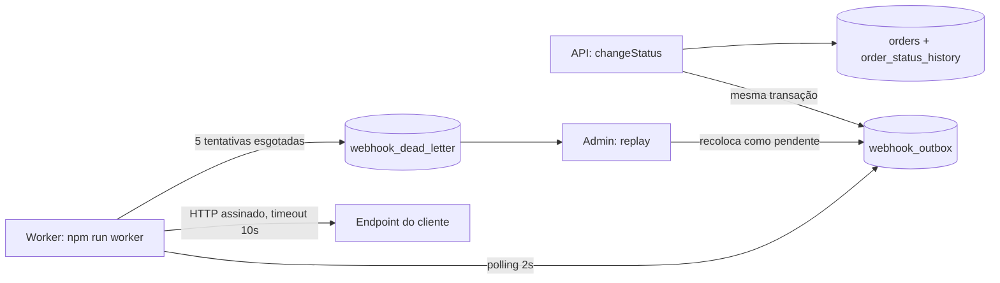

# RFC: Sistema de Webhooks de Notificação de Pedidos

## Metadados

| Campo | Valor |
|---|---|
| Autor | Larissa (Tech Lead), responsável por abrir o doc de design da feature ([09:50] Larissa) |
| Status | Em revisão |
| Data | 2026-11-16 |
| Revisores | Marcos (PM); Bruno (Eng. Pleno, Pedidos); Diego (Eng. Sênior, Plataforma); Sofia (Eng. de Segurança), **revisora obrigatória de segurança**, 2 dias úteis antes do deploy ([09:46] Sofia) |
| Documentos relacionados | [PRD](PRD.md), [FDD](FDD.md), [ADRs](adrs/README.md), [Tracker](TRACKER.md) |

## Resumo executivo (TL;DR)

Clientes B2B fazem polling em `GET /orders` para descobrir mudanças de status e pediram notificação em tempo real, entendida como menos de 10 segundos ([09:00] Marcos, [09:02] Marcos). Propomos webhooks **outbound** baseados em uma **outbox transacional no MySQL**: a mudança de status grava o evento na mesma transação, e um **worker em processo separado** lê a outbox por polling de 2 segundos e entrega por HTTP. A entrega é **at-least-once** com `X-Event-Id` para deduplicação, assinada com **HMAC-SHA256** e secret por endpoint, com **retry exponencial** de 5 tentativas e **dead letter** com replay manual por ADMIN. A ordem só é garantida por pedido e com um único worker. Ficam fora desta fase: email de alerta, rate limiting de saída, painel visual ([09:48] Larissa), arquivamento ([09:08] Diego) e webhooks inbound ([09:02] Marcos).

## Contexto e problema

Hoje o OMS não emite nenhuma notificação externa. Três clientes B2B (Atlas Comercial, MaxDistribuição e Nova Cargo) consultam `GET /orders` periodicamente para saber se algo mudou, o que torna a integração lenta e cara para eles; a Atlas sinalizou que pode migrar para um concorrente se a entrega não sair até o fim do trimestre ([09:00] Marcos). Para os clientes, qualquer latência abaixo de 10 segundos já é tempo real ([09:02] Marcos). O fluxo é só de saída, da plataforma para o cliente ([09:02] Marcos, [09:03] Sofia). A Atlas quer a feature até o fim de novembro, e a estimativa é de três sprints com a revisão de segurança incluída ([09:45] Marcos, [09:47] Larissa).

Restrições do código atual:

- `OrderService.changeStatus` (`src/modules/orders/order.service.ts`) já roda uma transação pesada: atualiza o pedido, grava `order_status_history` e mexe em estoque ([09:04] Bruno).
- O JWT identifica o operador (roles `ADMIN` e `OPERATOR` em `src/middlewares/auth.middleware.ts`), não o cliente; o `customer_id` não pode vir do token ([09:32] Bruno, [09:32] Larissa).
- As rotas ficam sob `/api/v1` (`src/app.ts`) e os módulos seguem controller/service/repository/routes/schemas ([09:27] Bruno).
- A API é um único processo Node (`src/server.ts`), sem fila, worker ou métricas, só logs Pino (derivado de `package.json`).

## Proposta técnica

### Visão geral

O `changeStatus` chama `publishWebhookEvent` com o tx corrente; se algum endpoint do customer quer aquele status, o evento é gravado na outbox já renderizado, e uma falha nessa gravação desfaz a mudança de status ([09:40] Bruno, [09:41] Diego). Da dead letter, só um ADMIN recoloca o evento na fila.

### Componentes

| Componente | Responsabilidade | ADR |
|---|---|---|
| `publishWebhookEvent` (chamado em `changeStatus`) | Filtrar por status, renderizar o payload e gravar o evento na transação corrente | [ADR-001](adrs/ADR-001-outbox-transacional-no-mysql.md), [ADR-007](adrs/ADR-007-snapshot-e-filtro-na-insercao.md) |
| Tabela `webhook_outbox` | Fila durável de eventos pendentes, em processamento, falhos e entregues | [ADR-001](adrs/ADR-001-outbox-transacional-no-mysql.md) |
| Worker (`src/worker.ts` (novo, a criar) + lógica em `webhook.worker.ts` ou `webhook.processor.ts` do módulo (novo, a criar)) | Polling, envio HTTP, registro de entregas, retry | [ADR-002](adrs/ADR-002-worker-separado-com-polling.md) |
| Retry e tabela `webhook_dead_letter` | Backoff 1m/5m/30m/2h/12h e guarda das falhas permanentes | [ADR-003](adrs/ADR-003-retry-com-backoff-e-dead-letter.md) |
| Replay administrativo | Reenfileirar evento da dead letter, restrito a ADMIN e auditado | [ADR-003](adrs/ADR-003-retry-com-backoff-e-dead-letter.md) |
| Configuração de endpoints e assinatura | url, secret, customer, estado ativo e status desejados; HMAC-SHA256 e rotação | [ADR-004](adrs/ADR-004-hmac-sha256-com-secret-por-endpoint.md) |
| Identificador de evento | UUID gerado na inserção, enviado em `X-Event-Id` | [ADR-005](adrs/ADR-005-entrega-at-least-once-com-x-event-id.md) |
| Módulo `src/modules/webhooks/` (novo, a criar) | CRUD de configuração, histórico de entregas, erros `WEBHOOK_`, reuso de AppError, Pino, Zod e `requireRole` | [ADR-006](adrs/ADR-006-reuso-dos-padroes-do-projeto.md) |

Contratos, payload, schema das tabelas e matriz de erros ficam no [FDD](FDD.md).

### Garantias e limites

- **Entrega:** at-least-once; o cliente pode receber duplicatas e deduplica pelo `X-Event-Id` ([09:24] Diego, [09:26] Larissa).
- **Consistência:** evento existe se e somente se a mudança de status commitou ([09:06] Diego).
- **Ordem:** garantida só por `order_id` e só enquanto houver um único worker ([09:12] Diego, [09:13] Larissa).
- **Latência:** polling de 2 segundos, dentro do requisito de menos de 10 segundos no caminho feliz ([09:09] Diego, [09:10] Larissa).
- **Falha do cliente:** timeout de 10 segundos conta como falha ([09:42] Diego); 5 tentativas cobrem quase 15 horas ([09:17] Diego).
- **Segurança:** HMAC-SHA256 do corpo em `X-Signature`, secret por endpoint, rotação com 24 horas de convivência ([09:22] Sofia); só URLs https ([09:23] Sofia).
- **Tamanho:** payload enxuto, sem items do pedido ([09:43] Diego); acima de 64KB gera erro e não é truncado ([09:23] Sofia, [09:24] Larissa).

## Alternativas consideradas

| ID | Alternativa | Trade-off que motivou o descarte | Fonte |
|---|---|---|---|
| **RFC-ALT-01** | Disparo HTTP síncrono dentro do `changeStatus` | Cliente lento trava a mudança de status de outros pedidos; cliente fora do ar não tem tratamento possível, pois desfazer o status não é aceitável | [09:04] Bruno, [09:06] Diego |
| **RFC-ALT-02** | Fila externa com Redis Streams | Mais infraestrutura para operar; Redis Cluster é overengineering para um time pequeno | [09:07] Larissa, [09:07] Diego |
| **RFC-ALT-03** | Trigger do banco ou NOTIFY/LISTEN para acordar o worker | MySQL não tem listener nativo; trigger não notifica processo externo; polling de 2s já atende | [09:09] Bruno, [09:09] Diego |
| **RFC-ALT-04** | Worker dentro do processo da API | Reinício da API derruba o worker | [09:11] Diego |
| **RFC-ALT-05** | Retry indefinido com backoff | Evento fica pendurado para sempre se o cliente sumiu | [09:15] Diego |
| **RFC-ALT-06** | 3 tentativas de retry | Mataria o evento em cerca de 30 minutos; já houve manutenção de 2 horas | [09:16] Bruno, [09:16] Diego |
| **RFC-ALT-07** | Dead letter como status "failed" na própria outbox | Tabela separada deixa a outbox limpa e preserva evidência para debug e replay | [09:17] Larissa, [09:18] Diego |
| **RFC-ALT-08** | Secret global da plataforma | Um vazamento comprometeria todos os clientes | [09:21] Sofia |
| **RFC-ALT-09** | Entrega exactly-once | Exige coordenação dos dois lados; complexidade muito maior | [09:25] Diego |
| **RFC-ALT-10** | `customer_id` implícito no JWT | O JWT é do operador, não do cliente | [09:31] Marcos, [09:32] Bruno, [09:32] Larissa |
| **RFC-ALT-11** | Filtrar eventos no envio | Grava linhas inúteis na outbox | [09:34] Diego, [09:34] Bruno |
| **RFC-ALT-12** | Guardar só `order_id` e renderizar no envio | O evento deixaria de refletir o estado do momento da mudança | [09:51] Bruno, [09:52] Larissa |

## Questões em aberto

Levantadas na reunião e não decididas ou adiadas:

"Não definido" na coluna de responsável indica que a reunião não nomeou quem decide nem quando.

| ID | Questão | O que falta decidir | Responsável / prazo | Fonte |
|---|---|---|---|---|
| **RFC-Q-01** | `customer_id` no body ou no path | Formato do contrato. Proposta, **pendente de confirmação**: `customerId` no body na criação e como query na listagem | Não definido; sugestão: sessão de revisão do doc (derivado de [09:50] Larissa) | [09:32] Larissa |
| **RFC-Q-02** | Rate limiting de saída: 50 mudanças em um minuto geram 50 chamadas ao cliente | Se e como limitar; "a gente observa e implementa se virar problema" | Não definido; depois de observar | [09:38] Diego, [09:39] Diego, [09:39] Larissa |
| **RFC-Q-03** | Escala para múltiplos workers | Particionar por `order_id` ou lock pessimista | Não definido; "problema do futuro" | [09:13] Diego |
| **RFC-Q-04** | Retenção e arquivamento das linhas entregues da outbox | Prazo ("30 dias ou assim") e dono | Não definido; fora desta feature | [09:08] Diego |
| **RFC-Q-05** | Endurecer as roles do CRUD de configuração | Quais roles podem configurar webhooks | Não definido; "mais pra frente" | [09:37] Sofia |
| **RFC-Q-06** | Detalhes de segurança da implementação | HMAC e geração de secret; se o `X-Timestamp` entra no conteúdo assinado ([09:44] Diego); como assinar nas 24h de convivência de secrets ([09:21] Sofia) | Sofia; antes do deploy | [09:46] Sofia |
| **RFC-Q-07** | Email ao cliente quando o webhook falha repetidamente | Se haverá alerta e com que gatilho | Não definido; próxima fase, após medir o impacto | [09:37] Marcos, [09:37] Larissa, [09:38] Marcos |

Ambiguidades identificadas na redação dos ADRs (a reunião tratou do tema, mas não fechou o detalhe):

| ID | Questão | O que falta decidir | Responsável / prazo | Fonte |
|---|---|---|---|---|
| **RFC-Q-08** | As 5 tentativas incluem o envio original? | A soma 1m+5m+30m+2h+12h (quase 15 horas entre a primeira falha e a última tentativa) só fecha com 5 retentativas após a falha inicial | Não definido | [09:15] Diego, [09:17] Diego |
| **RFC-Q-09** | `X-Event-Id` no replay e em múltiplos endpoints | Se o replay preserva o id e se vários endpoints do customer recebem o mesmo id | Não definido | [09:18] Diego, [09:25] Diego, [09:44] Sofia |
| **RFC-Q-10** | Granularidade da outbox | Uma linha por endpoint interessado ou uma por evento com distribuição no worker | Não definido | [09:33] Marcos, [09:44] Sofia |
| **RFC-Q-11** | Significado de `WEBHOOK_SECRET_REQUIRED` | Citado sem explicação; o FDD adota uma interpretação (derivado) | Não definido | [09:28] Bruno |

Identificada no código:

| ID | Questão | O que falta decidir | Responsável / prazo | Fonte |
|---|---|---|---|---|
| **RFC-Q-12** | Evento de criação do pedido | `OrderService.create` grava PENDING sem passar por `changeStatus`, logo a criação não gera evento; a reunião só tratou de "quando o status muda" ([09:00] Marcos) | Não definido | `src/modules/orders/order.service.ts` |

## Impacto e riscos

### Impacto

- **Código existente:** uma chamada nova em `changeStatus`; registro do módulo em `src/app.ts` e `src/routes/index.ts`; novos models UUID em `prisma/schema.prisma` ([09:51] Larissa); limpeza das tabelas novas em `tests/setup.ts`; script `worker` em `package.json` ([09:11] Larissa). Nenhuma dependência nova (derivado de [09:29] Bruno).
- **Operação:** um segundo processo para implantar e manter no ar, com o mesmo banco e PrismaClient próprio ([09:11] Diego, [09:30] Bruno).
- **Clientes:** precisam expor URL https, validar a assinatura HMAC e deduplicar pelo `X-Event-Id`; Marcos documenta isso no portal de desenvolvedor ([09:26] Marcos, [09:40] Marcos).

### Riscos

Probabilidade e impacto são avaliação desta RFC (derivado); as mitigações citam apenas o que foi decidido.

| ID | Risco | Prob. | Impacto | Mitigação |
|---|---|---|---|---|
| **RFC-RISK-01** | Falha ao gravar na outbox derruba a mudança de status, uma operação central de Pedidos ([09:40] Bruno) | Baixa | Alto | Gravação simples, sem chamada externa; testes ponta a ponta da integração previstos na estimativa ([09:46] Larissa) |
| **RFC-RISK-02** | Worker único parado ou retido por clientes lentos acumula eventos e estoura os 10 segundos | Média | Médio | Processo separado da API ([09:11] Diego); timeout de 10 segundos por chamada ([09:42] Diego); eventos não se perdem enquanto estão na outbox ([09:06] Diego) |
| **RFC-RISK-03** | Cliente não deduplica e processa o mesmo evento duas vezes ([09:25] Sofia) | Média | Médio | `X-Event-Id` estável por evento e documentação em destaque no portal ([09:26] Marcos) |
| **RFC-RISK-04** | Vazamento de secret pelo cliente, como já ocorreu ([09:22] Diego) | Média | Alto | Secret por endpoint, rotação com 24h de convivência ([09:21] Sofia) e revisão de segurança antes do deploy ([09:46] Sofia) |
| **RFC-RISK-05** | Rajada de eventos para um mesmo cliente sem limite de envio ([09:38] Diego) | Baixa | Médio | "Observar e decidir depois" ([09:39] Larissa); ver RFC-Q-02 |
| **RFC-RISK-06** | Crescimento contínuo da outbox sem política de retenção | Alta | Baixo | Índices em status e `created_at` ([09:08] Diego); retenção em RFC-Q-04 |
| **RFC-RISK-07** | Prazo da Atlas (fim de novembro) contra a estimativa de três sprints com revisão de segurança | Média | Alto | Estimativa por bloco ([09:46] Larissa); Marcos confirma o prazo com a Atlas ([09:47] Marcos) |

## Decisões relacionadas

- [ADR-001: Outbox transacional no MySQL](adrs/ADR-001-outbox-transacional-no-mysql.md)
- [ADR-002: Worker separado com polling](adrs/ADR-002-worker-separado-com-polling.md)
- [ADR-003: Retry com backoff e dead letter](adrs/ADR-003-retry-com-backoff-e-dead-letter.md)
- [ADR-004: HMAC-SHA256 com secret por endpoint](adrs/ADR-004-hmac-sha256-com-secret-por-endpoint.md)
- [ADR-005: Entrega at-least-once com X-Event-Id](adrs/ADR-005-entrega-at-least-once-com-x-event-id.md)
- [ADR-006: Reuso dos padrões do projeto](adrs/ADR-006-reuso-dos-padroes-do-projeto.md)
- [ADR-007: Snapshot e filtro na inserção](adrs/ADR-007-snapshot-e-filtro-na-insercao.md)
